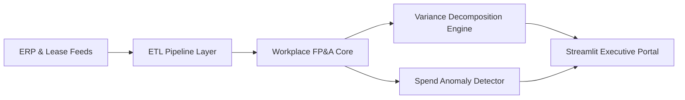

# Bloomberg Workplace Operations & Real Estate FP&A AI Engine

Enterprise financial planning, Capex/Opex optimization, lease economics, and spend anomaly detection platform for Bloomberg Finance L.P. Workplace Operations & CFO Organization.

## Overview
This platform automates monthly FP&A variance analysis, calculates cost-per-desk metrics across global facilities, and detects cost center spend anomalies using statistical outlier bounds.

## System Architecture



## Core Modules
- `src/core_engine.py`: Facility metrics, portfolio KPI calculation, rate/volume variance decomposition, and Z-score anomaly detection.
- `app/streamlit_app.py`: Interactive scenario portal for executive FP&A reviews.
- `tests/test_core.py`: Comprehensive test suite verifying all calculation modules.

## Installation & Testing
```bash
pip install -r requirements.txt
python -m pytest tests/ -v
streamlit run app/streamlit_app.py
```

## Author
Bhupesh Chandra Dimri (bhupeshcdimri21@gmail.com)
M.S. in Accounting Analytics & Data Technology, Pace University
Bloomberg BMC & BFF Certified
